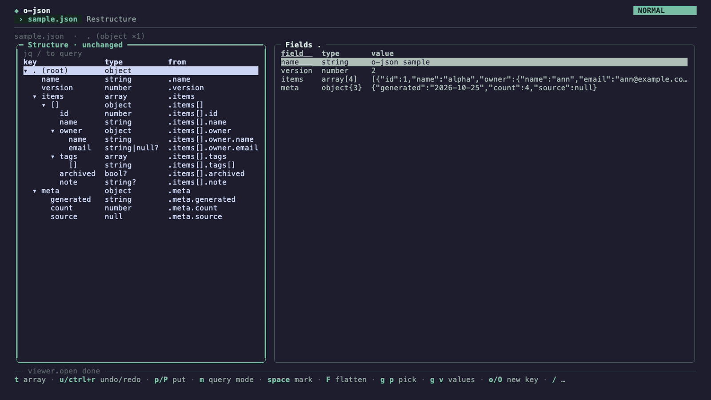

<p align="center">
  <picture>
    <source media="(prefers-color-scheme: dark)" srcset="assets/logo-animated-dark.svg">
    
  </picture>
  <br>
  <a href="https://github.com/ofamtools/o-json/tags"></a>
  <a href="https://pkg.go.dev/ofam.dev/o-json"></a>
  <a href="go.mod"></a>
  <a href="LICENSE"></a>
</p>

<p align="center">See a JSON document's shape and its arrays as tables, then edit, reshape and query it with jq.</p>

<p align="center"></p>

New here? Start with the [guide](docs/GUIDE.md).

A JSON structure and table viewer for the o family, built on [ochazuke](https://github.com/ofamtools/ochazuke) (Bubble Tea v2) with an [oden](https://github.com/ofamtools/oden) command line. It answers two questions about a document: what shape is it (every path, its types, how many values have it, which fields are optional), and what does an array of objects look like as a table. It never writes the document it reads unless asked: `restructure --out`, `export --out`, the viewer's `w` and `viewer.export` and the restructure page's write make a new file, and replace an existing one only when asked (`--overwrite`, or `W` on the page, which confirms before it writes the source).

```sh
o-json data.json                        # open the viewer (also: o-json view data.json)
o-json                                  # an empty document: e opens a file, p pastes JSON
curl -s https://... | o-json            # or read stdin (also: o-json -)
o-json structure data.json              # the shape as a tree
o-json table data.json .items           # an array as a table, optional columns last
o-json get data.json '.items[0].owner'  # one value
o-json restructure data.json --map spec.json        # a new document from a mapping
o-json restructure data.json --map spec.json --jq   # the same as a jq program
o-json export data.json --of .items > items.csv     # an array as csv (tsv, jsonl, md)
o-json --smoke data.json                # render one 80x24 frame to stdout and exit
```

## Highlights

- **The structure tree.** One row per path, not per value: types, counts, optional fields and repeated keys at a glance ([guide](docs/GUIDE.md#2-read-the-shape), [reference](#structure)).
- **Tables with hover sub-tables.** An array of objects as a table, optional columns last; a nested object or array opens as a sub-table under the row as the cursor reaches it ([guide](docs/GUIDE.md#3-an-array-as-a-table), [detail](docs/GUIDE.md#4-drill-into-a-row)).
- **The value editor.** Edit, add, delete and rename values in the table, each typed from what you write and each one undoable; nothing is written until you ask ([guide](docs/GUIDE.md#5-edit-values)).
- **Restructure and reshape, with the live jq panel.** Rename, move, nest and wrap shapes in the structure itself or on the restructure page, flatten and key arrays by a field; `g j` keeps the jq program and the mapping for every change on screen ([guide](docs/GUIDE.md#6-restructure-the-shape), [reference](#the-restructure-page)).
- **The query line.** jq as you type, with path completion, field chips and a function picker; path answers are the document's own nodes ([guide](docs/GUIDE.md#7-query-with-jq), [reference](#query)).
- **Export.** An array as csv, tsv, jsonl or markdown, from the command line or the viewer, or straight into o-csv ([guide](docs/GUIDE.md#8-export-and-write), [reference](#export)).
- **A story tester.** The viewer's interactions are [monogatari](https://github.com/ofamtools/monogatari) stories, played headless under `go test` and live in a separate tester build ([reference](#the-story-tester)).

## Install

```sh
go install ofam.dev/o-json@latest
```

Requires Go 1.27 or newer. From a checkout: `go build -o ~/bin/o-json .`; `make story-build` builds the story tester as `bin/o-json-story`, never over `o-json` (see [The story tester](#the-story-tester)).

## In the family

o-json is one of the o family's `o-*` tools, so `o json` and `mtm json` reach it once it is on PATH:

| Repo | Relation |
|---|---|
| [ochazuke](https://github.com/ofamtools/ochazuke) | The TUI framework the viewer is built on: panes, lists, the tree, modals, keys as binding rows, the palette, settings. |
| [oden](https://github.com/ofamtools/oden) | The command line: `o-json structure`, `table`, `doc ...`, and `o json` from the family root. |
| [monogatari](https://github.com/ofamtools/monogatari) | The story tester: o-json's stories run through its host, in the `monogatari` build only. |
| [matomeru](https://github.com/ofamtools/matomeru) (`mtm`) | Reaches o-json as `mtm json`, as it does every `o-*` tool. |
| [o-csv](https://github.com/ofamtools/o-csv) | The sibling o-json copies its shape from; `viewer.open-in` opens a table there. |

The full gate is under [Checks](#checks); o-json is MIT licensed ([License](#license)).

## Paths

Paths are jq style: `.` is the whole document, `.key` and `["odd key"]` step into an object, `[2]` (or `[-1]`, from the end) into an array, and `[]` means every item. The leading dot may be left off (`items[0].name`). A path with `[]` names many values. The structure uses `[]` paths, so `.items[].owner` is the shape of every item's owner.

## Structure

One pass over the document records, for every `[]` path, the types seen, how many values have it, and, for an object field, how many of the objects at its parent have it. A field is optional when some of those objects lack it. Fields are listed most common first, ties in the order they first appear, so optional fields come after the shared ones.

```
$ o-json structure testdata/sample.json
.               object         1
  name          string       1/1
  version       number       1/1
  items         array        1/1  4 items
    []          object         4
      id        number       4/4
      name      string       4/4
      owner     object       4/4
        name    string       4/4
        email   string|null  2/4  optional
      tags      array        4/4  0..2 items
        []      string         4
      archived  bool         1/4  optional
      note      string       1/4  optional
  meta          object       1/1
    generated   string       1/1
    count       number       1/1
    source      null         1/1
```

A key an object repeats (`{"id": 3, "id": 33}`) counts once for that object, so the count and the optional flag stay true. Every read takes the last value at the first key's position, as jq (and any parser that builds a map) does: the viewer, the tables, `get`, the shape and `restructure` all agree with jq. The structure notes `duplicate key (N)`, N being the most times one object has it, and the viewer puts the field's name on the error background (setting `json.duplicate-tone`: `background`, the default, or `foreground`, the error colour) and says `duplicate key "id" (2): jq keeps the last` on the breadcrumb.

`--format json` prints the same tree as JSON (`{key, path, count, of, types, min_items, max_items, optional, duplicates: {objects, most}, children}`).

## Tables

`o-json table FILE [PATH]` lays out an array (or the values a `[]` path names) with one row per item and one column per key any object item has, in the same frequency order, so optional columns are the rightmost. A missing field is a blank cell, which is not the same as `null`. Items that are not objects fill a `(value)` column. An optional column's title ends in `?`. Objects and arrays inside a cell are compact JSON.

```
$ o-json table testdata/sample.json .items
id  name   owner                                     tags            archived?  note?
1   alpha  {"name":"ann","email":"ann@example.com"}  ["red","blue"]
2   beta   {"name":"bob"}                            []              true
3   gamma  {"name":"cy","email":null}                ["green"]                  third
4   delta  {"name":"dee"}                            ["red"]

$ o-json table --format markdown testdata/sample.json '.items[].owner'
| name | email? |
| --- | --- |
| ann | ann@example.com |
| bob |  |
| cy | null |
| dee |  |
```

`--format json` prints `{path, columns: [{name, count, optional, types, self}], rows}`, with the rows as they are in the document.

## get

`o-json get FILE PATH` prints the value as indented JSON with its keys in document order. A `[]` path prints each value it names on its own (`--format json` makes them one array), and `--raw` prints strings without quotes.

```
$ o-json get testdata/sample.json '.items[].owner.name' --raw
ann
bob
cy
dee
```

## query

`o-json query FILE QUERY` runs a jq query through gojq (`github.com/itchyny/gojq`, pure Go; no `jq` binary needed) and prints each result as indented JSON (`--compact`: one line each). A query that is a path expression (`.items[] | .name`, `select(...)`, `.[2:]`) is run as `path(QUERY)` and prints the document's own values, keys in document order, as jq does. A query that builds values (`{...}`, `map`, arithmetic) prints gojq's output, whose object keys are **sorted**; and where gojq iterates an object (`.[]` on an object, `..`), it goes in sorted key order where jq keeps the document's. An error names its column. The viewer's query line runs the same engine.

```
$ o-json query --compact testdata/sample.json '.items[] | select(.tags | length > 0) | .owner.name'
"ann"
"cy"
"dee"
```

## restructure

`o-json restructure FILE --map SPEC.json` makes a new document from a mapping of structure paths. It works on shapes: an entry names `.items[].owner.name`, not one item's, so it maps that field of every item.

A mapping is `{"map": [entries]}` and an entry is `{"from": PATH, "to": PATH}`. `from` is a path the structure lists; `to` is the path in the new document, in the same syntax (keys and `[]`, no indexes). An entry without `from` makes a new object (a wrapper), and `"to": null` drops its `from`. The `to` paths make a tree:

- A node with children is built from them: an object from its keys (in the order the mapping first names them), an array from its `[]` item.
- A node without children copies the value at its `from`, keys in document order.
- An object entry with `"order": "document"` keeps each source object's own key order. It needs an object `from` and children mapped directly from its fields (renames are allowed). Omit `order` to use mapping order. Exported viewer mappings carry this rule, so rerunning them keeps the same order.
- A `[]` item needs a `from`: the values it is made of. Inside it, every `from` lies under the item's own `from`, so `{"from": ".items[]", "to": ".records[]"}` with `{"from": ".items[].owner.name", "to": ".records[].owner"}` makes one record per item. A `[]` item's `from` may fan out further: `{"from": ".items[].tags[]", "to": ".all_tags[]"}` collects every item's tags. A key takes one value, so a key's `from` may not.
- A field is copied only where it is present. An optional field gives its key to the objects that have it and no others; a step into a value of another type (`.owner.name` where `owner` is sometimes a string) counts as absent, never as an error. A wrapper is always there, even empty.

```json
{"map": [
  {"from": ".version", "to": ".v"},
  {"from": ".items[]", "to": ".records[]"},
  {"from": ".items[].id", "to": ".records[].id"},
  {"to": ".records[].info"},
  {"from": ".items[].name", "to": ".records[].info.name"},
  {"from": ".items[].note", "to": ".records[].info.note"},
  {"from": ".items[].owner.name", "to": ".records[].owner"},
  {"from": ".items[].tags[]", "to": ".all_tags[]"},
  {"from": ".items[].archived", "to": null}
]}
```

`--jq` prints a jq program that makes the same document from any document of this shape, and never fails on it: an iteration is `[]?` (or a type test where the values may be objects), an optional field is copied under `if has("k")`, and a step into a value that may not be an object tests its type first. For `testdata/restructure.json` and `testdata/restructure.map.json`:

```jq
{"v": .version, "records": [.items[] | {"id": .id, "info": ({"name": .name} + (if has("note") then {"note": .note} else {} end))} + (if has("size") then {"size": .size} else {} end) + (if (.owner | type == "object") then {"owner": .owner.name} else {} end) + {"contact": (if (.owner | type == "object" and has("email")) then {"email": .owner.email} else {} end), "tag_names": [select(has("tags")) | .tags[]?.t]}], "all_tags": [.items[] | select(has("tags")) | .tags[]?], "names": [.items[].name]}
```

**Value patches.** A mapping may end with `"patches": [...]`, single-value edits applied after the restructure, in order, each at a concrete path of the restructured document (indexes, no `[]`). The viewer's data pane makes them (below), and `--map` reproduces them:

```json
{"map": [...],
"patches": [
  {"op": "set", "path": ".records[1].owner", "value": "bo"},
  {"op": "delete", "path": ".records[3]"},
  {"op": "add", "path": ".records[0].nick", "value": "al", "after": "id"},
  {"op": "add", "path": ".all_tags[0]", "value": "first"},
  {"op": "rename", "path": ".records[2].id", "key": "key"}
]}
```

`set` replaces a value (`"path": "."` the whole document); `delete` removes a field or an item; `add` adds a key the object lacks (after the key `after`, else last) or inserts an item at an index (at most the array's length); `rename` renames one key in that one object. A patch applies only where its target is there: every step of its path (for `add`, the container, without that key); a `rename` onto a key the object has is not there either. A patch whose target is not there is **orphaned**: kept, skipped, never an error, and it applies again once its path is back. `--jq` appends each patch as a guarded `setpath` / `delpaths` step after the restructure, testing the same thing, so the program's output equals the Go result.

**Reshape steps.** Some restructures make rows or keys out of values, which a map of shapes cannot say. A mapping may end with `"then": [...]`, steps applied in order after the map and its patches; each step reads the document the ones before it made, and carries its own `map` and `patches`, which read the step's output as the first map reads the source (a step without a `map` copies its output). The viewer makes them (`F`, `g k`, `g v`, `g e`, below), and `--map` and `--jq` run them:

```json
{"map": [...],
"then": [
  {"op": "flatten", "paths": [".people[].name", ".people[].address.city", ".people[].tags"], "arrays": "join", "join": ";", "names": "leaf"},
  {"op": "key-by", "path": ".", "field": "name", "duplicates": "rename", "missing": "_missing", "map": [
    {"from": ".Ann", "to": ".first"}
  ]}
]}
```

- `flatten` makes a flat array of objects, one per item of the paths' nearest common array (their longest common prefix, cut back to its last `[]`; the document itself when they share none, one row; a marked array stands for its items). Each row holds only the marked fields, under the dotted path from the item (`address.city`), or with `names` `leaf` (the default) the last key where no other field ends in it (`city`). An item missing a field leaves it out of its row; an item with none of them is an empty row, never dropped. An array among the fields follows `arrays`, the export's rule (`export.arrays`): `join` joins each column's values across the items with `join` between them (`tags: "a;b"`, `orders.sku: "s1;s2"`), `json` writes them as compact JSON (`["a","b"]`), and `rows` makes one row per item with the other fields repeated (several arrays give every combination; an array of objects keeps its fields together per element).
- `key-by` turns the array at `path` (keys and `[]`; `.groups[].items` keys every group's items) into an object keyed by each item's `field` (its text, as jq's `tostring` writes a scalar). `drop: true` takes the field out of each value. Items that share a key: `duplicates` `rename` (the default) gives the later ones `KEY-2`, `KEY-3` (as o-json names any taken key), `last` keeps the last (jq's `INDEX`), `group` puts every item in an array under its key. Items without the field (not an object, no field, or the field an object or array) go under `missing` (default `_missing`, numbered past a taken key), in an array: nothing is dropped.
- `values` turns the object at `path` into the array of its values, and `entries` into `{key, value}` pairs: the reverses of `key-by`. A value at `path` of another kind stays as it is, in every step.
- `lift` lifts the array at `path` (its last step a key) into the object that holds it, at its place: item *i* (from 1) becomes the key `PREFIX-i` (`prefix`, default `new-key`) and the array's key goes (`]` makes it, `node.unwrap` on an array). A key the object has already that an item takes goes: the lifted value wins.

`--jq` appends each step as one filter (`(MAP) | (STEP) | (STEP'S MAP)`), so the program's output equals the Go result; `TestReshapeCasesAgreeWithJQ` runs every case through gojq and, when it is on PATH, jq. Compared with jq:

| o-json step | jq |
|---|---|
| `flatten` (no arrays among the fields) | `[.people[] \| {name, city: .address.city}]` (absent fields left out rather than `null`) |
| `flatten` `arrays: join` | `... \| {tags: (.tags \| join(";"))}` per item |
| `flatten` `arrays: rows` | `[.people[] \| {name} + (.tags[] as $t \| {tags: $t})]`, an empty array keeping its row |
| `key-by` `duplicates: last` | `INDEX(.[]; .id)` (o-json files items without the key under `_missing`; `INDEX` files them under `"null"`) |
| `key-by` `duplicates: group` | `group_by(.id) \| map({(.[0].id\|tostring): .}) \| add`, in first-seen order rather than sorted |
| `values` | `[.[]]` |
| `entries` | `to_entries` |

`--mapping` prints the mapping with every shape it leaves out added as a drop (`{"from": ".items[].archived", "to": null}`), so it reads as the whole story of the source; the output is itself a mapping, one entry per line.

A key an object repeats is read as jq reads it: the last value, at the first one's position. The Go result, the jq program, the viewer and `table` therefore agree.

Output goes to stdout. `--out PATH` writes it to a new file instead (atomically: a temporary file beside it, then a rename); an existing file, the source among them, is replaced only with `--overwrite`. `--out` takes a value: the flag parser has no optional values, so there is no default `NAME.restructured.json`.

## export

`o-json export FILE|- [--map SPEC.json] [--of PATH] [--format csv|tsv|jsonl|md] [--columns A,B] [--arrays join|json|rows] [--join SEP] [--null empty|null] [--jq] [--out PATH [--overwrite]]` writes one array of the document as a table file. `--map` restructures first (patches included), as `restructure` does, so the export is of the new document.

- **Rows:** the items of the array at `--of` (default `.`), one per item; a `[]` path (`.items[].owner`) makes a row of every value it names. A value that is not an array is one row with one column, `value` (a container as compact JSON); so is each item of an array that is not an object.
- **Columns:** an object item's fields, in structure order (the order `structure` and the data pane list them: most common first, then first appearance). A nested object flattens to dotted columns (`owner.name`, `owner.email`); an empty object is the cell `{}`; a field that is sometimes an object and sometimes a scalar has its own column first, then the dotted ones. `--columns owner.name,id` picks and orders them (an unknown name is an error that lists the columns).
- **Arrays in a cell** (`--arrays`, the viewer's setting `export.arrays`): `join` (default) joins the items with `--join` (`export.join`, default `;`), a container item as compact JSON; `json` writes the array's compact JSON; `rows` writes one row per item with the other columns repeated (an object item flattens to `tags.name`; an empty array keeps the row with an empty cell; two arrays give every combination).
- **Missing and null:** a field an item lacks is an empty cell; `null` is an empty cell, or the text `null` with `--null null` (`export.null`).
- **Formats:** `csv` and `tsv` (encoding/csv, quoted only where needed, which o-csv reads), `md` (a Markdown table), `jsonl` (each item as one line of JSON, not flattened; `--columns` keeps those top-level keys). The format is `--format`, else `--out`'s extension, else csv.
- **jq:** `--jq` prints a jq program (run it with `jq -r`) that makes the same csv or tsv from the source: the restructure's program, then the export's `@csv` / `@tsv` step over the same columns. The two agree record by record; the text differs where the formats do: jq's `@csv` quotes every string, and `@tsv` escapes a tab, newline, carriage return or backslash (`\t`) where encoding/csv quotes the cell (and quotes a cell holding `"`). jsonl and md have no jq form. The columns are the ones this document has: the program is for this document, not for every document of its shape.

Output goes to stdout, or with `--out` to a new file (atomically); an existing file is replaced only with `--overwrite`.

In the viewer, `w` to a path ending in `.csv`, `.tsv`, `.jsonl` or `.md` writes the export instead of JSON (any other extension is JSON, as before), with the same rules: a new file, an existing one asks, the source never. By default it exports the array under the cursor: the selected array's items, or the nearest array holding the selected path (`.items[].owner.name` exports `.items[]`), else the table the data pane shows. It reads the shown document (in the edited view, the restructure and the value edits applied). An export is not the document: the edits stay unsaved (`[+]`), and a document of no file keeps no name. `: viewer export {path, format, of, columns}` (the args form asks for the path) exports with explicit choices; an existing file asks (`viewer.export-overwrite`, which keeps them). `: restructure jq {format: csv}` shows the jq program of that export (`{yank: true}` also copies it).

o-csv is a full-screen program and ochazuke has no way to hand the terminal to another one (an `actions.json` command runs with its output captured), so there is no "open in o-csv" verb yet: `w items.csv`, then `o-csv items.csv`.

## For a host: the doc noun and the catalog

`o-json doc structure|table|get FILE [PATH]` gives the same answers as JSON through ochazuke's `cli.Shell`, and `o-json catalog` describes the noun, so `o-nabe extension register json` can mount it. A value keeps the document's key order.

`o-json doc rows FILE [PATH]` is `doc table`'s rows for a host and for the formats: JSON Lines `{noun: "item", id: PATH, data: ITEM, cells}`, the item in document order and one cell per table column. `--format table|markdown|toon` prints them as a table under `doc table`'s columns (an optional column's title ends in `?`, numbers are right-aligned, and on a narrow terminal the optional columns drop first):

```
$ o-json doc rows testdata/sample.json '.items[].owner' --format table
name  email?
ann   ann@example.com
bob
cy    null
dee
```

`doc get` of an array of objects prints under `--format` too (its fields as columns). `doc structure` and `doc table` answer one object, so `--format` other than json prints their JSON with a note on stderr.

## The viewer

The structure trees (original and restructured, in the viewer and the restructure page) draw branch guides `├─`, `└─` and `│`. Set the framework setting `tree.guides` to `off` to hide them everywhere; its default `app` keeps o-json's choice. Nested data tables keep their table layout.

The viewer has a breadcrumb line and then two panels. The breadcrumb shows the file (followed by `[+]`, as in vim, while the structure has edits no write saved), the selected path with its types and presence (and `← from` for a node that moved), the selected row's own path when the data panel holds the focus, the active filters, and the value edits (`2 value edits (1 orphaned)`).

- **The data pane follows the structure cursor.** On an object or an array (a collection) it shows that path: its fields, its table, its JSON (`v`). On a path of plain values (no object or array among them, `.items[].name`), or of lists of plain values (`.items[].tags`, arrays of strings or numbers), it keeps the collection that holds it, the one it already shows (`.items` or `.items[]`) or else the nearest one up, and highlights the path there in the accent (the `marker.queued` tone, as the restructure page's origin highlight): its column in a table, the cursor's column moved onto it so a column off screen scrolls into view while the cursor's row stays, or its row in a fields view, the cursor moved onto it; in an object's one row, its key's column. The lit column widens to its data so it can be read (setting `structure.lit-width`, default `fit`): its cells written out (a list's items joined with ` · `, an object or array as JSON) and as wide as its widest cell in the first 2,000 rows, up to the pane less room for the row's first columns; the other columns narrow first and then scroll off (`‹N` / `N›`), and the widths go back when the highlight moves (`normal` keeps the widths). The breadcrumb names the cursor's path. Setting `structure.scalar-follow` (`highlight`, the default) `show` shows the plain values alone (a one-column table, or the value) as before. A document that is itself a plain value is shown either way.
- **Left: the structure, edited in place.** The structure pane is the restructure editor: it opens as a copy of the document's shape (`Structure · unchanged`), every shape a node mapped to itself, so the output is the input; the title reads `Structure · edited [+]` once an edit (structure or value) makes it differ from that copy, and `unchanged` again when undo brings it back. Every key of the restructure page's tree works here (below): `d d` / `y y` / `p` / `P`, `> j` / `> k` / `> >` / `g >` / `< <`, `S`, `t`, `r`, `o` / `O` / `a`, `V` selections, `u` / `ctrl+r`. Each node keeps the shape path it came from (the `from` column), wherever it moves. On a large document the restructured document the data pane shows is built off the event loop once a rebuild takes more than 20 ms: the keys stay immediate, and the last result stays on screen until the new one arrives (writes and exports always use the current one). Nothing is written until `w`: `w` (`restructure.write {path}`) writes the restructured document to a new file, an existing one asks first, and the source is never written; `W` replaces an existing file, and the source after one confirm. A shape whose values mix types (an object in some items, `null` in others) is one node that copies its values, so the copy never changes them; an object with more than 200 keys likewise.
- **`T` flips original and edited** (`restructure.show`): the structure pane shows the original structure tree (`Structure · original`), read-only, one row per path with its types and count (an optional field's name ends in `?`), and the data pane the original document; `T` again goes back to the edited one, on the same shape. The search and the type filter (`/`, `n`, `N`, `t`, `esc`) and `p` paste work on the original; on the edited tree `/` filters its rows, `t` turns a key into an array and `p` puts nodes. A structure with more than 150 paths opens collapsed below the second level, and an object with more than 200 distinct keys (a map) lists the first 200 and a `… N more fields` row.
- **Key order survives edits and writes.** The edited copy keeps every object's source key order, including different orders in separate array items and nested objects. The edited structure lists fields by first appearance (`structure.order=document`, the default); `frequency` restores common fields first, optional fields last, and that shared write order. The setting takes effect on the next document. Table columns and the original shape keep their frequency order. Value edits and renames keep a key's position; explicit structure reordering, wrapping or copying uses the edited tree's order for that object. Duplicate keys keep their first position and last value, as jq does. Writes re-indent JSON; whitespace is not retained. This is document persistence in o-json; Vim's text buffers already retain line order, so no new Vim key or command is involved.
- **The setting `structure.editable`** (default on) off keeps the viewer read-only, as it was: the original tree only, no `T`, and the restructure page (`M`) alone edits. It takes effect on the next document.
- **Right: the selected path's data**, from the edited document while the edited structure is shown: as a node moves, the data moves with it (the restructured document, as `w` would write it), and the focused node shows its restructured value. One array, or the values of a `[]` path, is a table with a `#` column, columns in frequency order and optional ones last. A value edit keeps the order the table had (setting `table.stable-columns`): renaming one object's key puts the new key's column beside the old one's, an added key's column goes beside the key it was added next to, and the cursor follows the edited key. One object is **one row**, the way a hover sub-table draws an object: its keys are the header, in document order, and its values the cells, with no `#` column (setting `object.view`, default `row`; `fields` shows the labeled `field  type  value` rows as before; changing it shows the open object again in the other form). An object of records (`key-by`'s output) is that same one row, each record a cell. More keys than fit scroll as a table's columns do (`‹N` / `N›`). In every table a cell holding an object or an array shows its size, `{63}`, `[46]`, `[]` when empty, since its data opens under the row (`table.nested`) or in the detail. One scalar is shown as is. Column widths come from the first 2,000 rows, so they hold still while you scroll. On a narrow screen the widest columns narrow first, and after that columns drop from the right, so the optional columns go first. Only the rows on screen are in the table, so a 100,000-row array costs one screen per key.
- **Value edits** (setting `data.editable`, default on): in the edited view the data pane edits single values, as a second layer of **value patches** applied after the restructure (the structure edits stay shape-level, for every item). `r` or `i` (`value.edit`) opens the **value editor**, a compact modal over the table (setting `value.editor`, default `modal`): its title is the value's path (`.items[1].name`), the old value is dimmed above the input with its type, the input holds the value selected (`rename.select`), so typing replaces it, and a badge beside it shows the type the text will be set as, read as you type: a number, `true`/`false`, `null`, an object or array in JSON, `"…"` to force a string (`"42"`), anything else the text as a string (a string that would read as another type opens quoted; text that starts like JSON but does not parse is noted, as it would be set as a string). `enter` sets it and the cursor stays on the edited cell; `esc` goes to normal mode with the text kept (as in ochazuke's editors), where `enter` sets, `q` cancels with nothing changed, and a second `esc` leaves as setting `value.leave` says (`set`, the default: the text is the edit, one undo step, as a record editor keeps each change; `cancel`: nothing changed, as a prompt); the table stays drawn as it was behind the modal. An object or array value opens as indented JSON on several lines: there `enter` is a new line, `esc` goes to normal mode, and `enter` sets. The modal's last line is its keys, from the bindings. `value.editor inline` is the editor as it was: an input drawn over the row, its prefix showing the type, with the same keys (`enter` sets, `esc` normal mode, then `esc` leaves as `value.leave` says). `d d` (`value.delete`) deletes the field or item; `o` (`value.add`) adds one after it and `O` (`value.add {before: true}`) before it: in an object the value editor asks the key (the `restructure.new-key` placeholder selected) and the value (`null` selected) in one modal (`enter` or `tab` moves from the key to the value, `shift+tab` back, `enter` on the value adds both; a key the object has is noted, and the add takes the next free name), in an array an item; `K` (`value.rename`) renames the key in that one object (a key the object has already is numbered past its keys, `id-2`, and an empty one takes the `restructure.new-key` placeholder, as an add names its key; the modal notes it before `enter`, which always sets); `y` copies the value with its type and `p` (`value.paste`) puts the register's value over this one. In a table the value is the cell under the cursor (a cell the row lacks is added by `r` and `p`); on the `#` column it is the row. The detail (below) opened from the edited view takes the same keys on its rows (the value editor opens over it). Each edit is one undo step on the restructure's stack (`u` / `ctrl+r` from the data pane and the detail too), nothing is written until `w`, and `[+]` covers them. A value edit names a concrete path of the restructured document (`.items[1].name`). A later structure edit keeps it while its path is there; one that removes or renames the path **orphans** it: kept, skipped (not applied), counted on the breadcrumb (`2 value edits (1 orphaned)`) and listed by `: value patches` with `orphaned: true`; it applies again once the path is back (`u`). `: value drop {index}` forgets one. The mapping carries them as `"patches"` (above), so `w`, `restructure.jq`, `restructure.export-map` and `o-json restructure --map` all give what the data pane shows. Off, the data pane is read-only.
- **The jq query line** (setting `query.line`, default on): the structure pane's first row is a live jq query (gojq, as `o-json query`). `/` (`jq.focus`) is the only way in (the line is no stop of `tab`'s ring) and types at its end; `esc` or `enter` (`jq.leave`) goes back where `/` came from, the query kept. The query is drawn as text with each field reference (`.a`, `.a.b[]`, `."k"`, `.[0]`) a chip on a dim background (ochazuke's `chip` tone), the chip under the cursor bright while the line is focused (`chip.focused`; setting `query.chip-focus` `line` brightens every chip then); `|`, brackets, commas and names stay plain. Typing `.` just types a dot. Path completion is opt-in (setting `query.complete-paths`, default off): on, typing `.` (at the start, or after `|` `(` `)` `,`) offers the field keys of the shape the query reads there: the stage's input after `|`, the keys of `.owner` after `.owner.`, each item inside `map(`; an array field is offered as itself and with `[]`. The data pane shows its results as you type (off the event loop, after a pause, a newer run cancelling the older): a path query's results are the document's own values, so key order and paths are kept; a query that builds values shows gojq's output and the breadcrumb says `keys sorted by jq` (or `not in document order` where gojq iterated an object), as the results panel's title does (`jq {version, name}  keys sorted`). An error underlines its column, a caret line under the query names it (its row is kept while the line is focused, so an error that comes and goes never moves the tree), and the last good results stay. The empty query shows the document as the tree's selection does. The query runs on the shown document: the edited one, or the original after `T`. Value edits are not available while results are shown. In the line, `ctrl+v` starts a visual selection and `[`, `{` or `(` wraps it (`jq.wrap`). With `query.line` off, `/` is the path search (`viewer.search`) as before.
- **Query mode** (`m`, `jq.mode`): switches the structure pane (edited or original) from its edit keys to building the query from the structure; the mode badge reads `QUERY` and the pane's title shows how the highlighted field would be written (`.email · query · unchanged`, or `edited` once edited: the field first, so a narrow pane keeps it). jq's own characters are the keys, and they write at the anchor (the query line's cursor): `.` the highlighted field's path (`jq.path`: relative to what the query reads there, `.people[] | ` then `.email`; chained onto a path that ends there; after a comma when a term is there; `key: path` inside `{ }`), `|` its path and a pipe (`jq.pipe`), `]` its path iterated (`jq.iterate`, `.people[]`) or, before a closing bracket, out of it (`jq.close`, also `}` `)`), `[` / `{` / `(` open a collection to fill (`jq.open`), `,` a comma, `a` anchors after the field's reference in the query (appended when it has none: what you choose next attaches there), `backspace` takes back the token before the anchor (`jq.erase`), `u` / `ctrl+r` undo and redo the query. The edit keys (`d d`, `> >`, `r`, `t`, `p`, ...) do not answer in query mode; motions and folds do; `m` or `esc` goes back. `[` `.` `.` `]` on `.a` then `.b` builds `[.a, .b]`.
- **Functions**: `ctrl+f` (`jq.function`), in the line or in query mode, picks a jq builtin (gojq's `builtins`, each with its arity; a name matches from its start or a word in it, case as ochazuke's `search.case` says: smart by default, so `IN` finds `IN` and `INDEX` and `in` finds those and `index`). It is written with an empty slot (`□`, an empty chip) per argument, `sub(□; □)`; in the line the first slot is selected, so typing fills it, and `tab` (`jq.next-slot`) selects the next. `ctrl+f` on a selected slot nests a call there. The query does not run while a slot is empty. `: jq set {query}`, `jq clear`, `jq yank`, `jq state` reach the query from the palette and the CLI.
- **Nested data in tables** (setting `table.nested`, default `hover`): with the data pane's cursor on a cell holding an object or an array (a table cell, not `#`, a key of an object's one row, or a field), a small sub-table of its data opens directly under the row, with no key, and moving away closes it. Each level is indented a step from the one above and has its own column widths: an object is a line of keys over a line of values, an array of objects a header and a line per item, an array of scalars one line joined with ` · `, any other array a line per item (`#` and the value). The sub-table's lines are cursor stops, and the table's keys work on them with the same meaning: `j`/`k` (and counts), `ctrl+d`/`ctrl+u` and the page keys walk the drawn lines, from the row down into a sub-table and out its bottom to the next row; `h`/`l`, `0`/`^`/`$` and `N|` move along a line (`rows.column`). A nested cell under the cursor in a sub-table opens its own sub-table one step deeper, so only the chain under the cursor is open; deeper values read `{N}` or `[N]`. Up does not walk into a sub-table it meets from below, since only the chain under the cursor is drawn. `g g` and `G` go to a row and leave the sub-table. The list's column chooser and resizing (`g c`, `z >` `z <` `z =` `z p`) act on the row's columns, so a sub-table does not offer them. A long level shows `table.nested-rows` lines (default 8, two fewer per level) and scrolls with the cursor; its columns scroll to keep the cursor's cell on screen (`‹` marks the hidden ones), and the rows above scroll up under the header to keep the cursor's line in view. The value under a sub-table's cursor is what a table cell is on a row: the cell's value, a cell the item lacks (`r` and `p` add it), the item on `#`, the array on a joined list. `y` copies it, `enter` opens it in the detail (a scalar opens the object or array it is in), and the value edits act on it: `r`/`i` opens the value editor on the line's cell (with `value.editor inline`, the input on the sub-table's line), `d d`, `o`/`O`, `K` and `p` as on a row, each one value edit (`u` undoes it), the walk staying on the line. `table.nested summary` is the view as it was: the cell shows its size and `enter` drills in the detail.
- **Detail**: `enter` on a table row, or on a cell or field that holds an object or an array, opens it in a modal. An object there is one row, as on the data pane (`object.view row`): `h`/`l` move along its keys, `enter` on a nested cell steps into it, and `backspace` steps back out onto that key's column. An array, and every object under `object.view fields`, is labeled rows: `enter` (or `l`) on a nested object or array steps into it, and `h` or `backspace` steps back out. Beneath it, as beneath every modal, the page is drawn without its cursor bars, since the detail shows that row (ochazuke's `modal-highlights`, `plain` in o-json).

The file is read off the event loop (`viewer.open`, and `viewer.load` reads it again), and the screen says `loading …` until it is done. A parse error gives the line and column. The panels sit side by side from 60 columns up and stack below that. `ctrl+w >` and `ctrl+w <` move the divider (the tree's width, or its height when stacked) and `ctrl+w =` puts it back; the divider is remembered in `~/.local/state/o-json/panes.json`.

### Files and the empty document

The viewer holds one document, like a vim buffer.

- **No file:** `o-json` with no file (and stdin a terminal) opens an empty document; the breadcrumb reads `[no file]` and names the keys that fill it, and the data pane says `No document is open.` and lists them with their verbs (`e` `doc.open`, `p` `doc.paste`, `M` `restructure.open`; keys from the bindings, so a rebound key shows as bound). Nothing opens by itself: the chooser waits for `e`. The setting `empty.hint` (default `true`) turns the data pane's list off. The command line forms that read a file (`structure`, `table`, `get`, `doc VERB FILE`, ...) still say a file is required. `: viewer new` empties the viewer from inside; when the structure has edits no write or export-map saved, it asks first (`viewer.discard`, and `u` brings the edits back).
- **Open:** `e` (`viewer.open {path}`, a path parameter) opens ochazuke's path chooser directly (its one missing argument is a path; ochazuke's `forms.single-path`): `browse` starts in the open file's folder (the working directory for a document of no file), `recent` lists the recently opened files, newest first, and `typed` completes a path as you type; `ctrl+o` cycles the sources (`alt+o` back; ochazuke v0.59 moved them off `tab`, which now cycles the match mode: substring, fuzzy, regex). The write verbs' paths (`w`, `viewer.export`, `restructure.write`) are path parameters that may name a new file. `R` (`viewer.load`) reads the current file again. With edits no write saved, `e` and `R` ask once first (`viewer.discard {path}`); the new document starts as a copy of its shape, and `u` brings the dropped edits back.
- **The `doc` noun (the open document):** the viewer holds the open document's file as its state (`doc.show` answers `{path, open, name, size, unsaved}`; `path` is empty for none or a document of no file). `doc.open {path}` opens a file into the running viewer, replacing the current document; it is `viewer.open` under the document's name, one operation, so its path is a path parameter (the palette and a key open ochazuke's path chooser), and with edits no write saved it asks first (`viewer.discard`; `u` brings them back). `doc.reload`, `doc.new`, `doc.paste` and `doc.write` are `viewer.load`, `viewer.new`, `viewer.paste` and `viewer.write` the same way. The command line's `o-json doc VERB FILE` is a separate runtime that reads a FILE per call; these verbs are the running viewer's (palette, bindings, a host driving it).
- **Recent files:** every file opened is recorded, newest first, in `~/.local/state/o-json/recent.json` (`$XDG_STATE_HOME` if set). The setting `recent.size` (default 10; 0 keeps none) is how many; a file that is gone is left out. `: viewer recent` lists them.
- **Paste:** `p` (`viewer.paste`) parses the system clipboard (pbpaste, wl-paste, xclip or xsel) into the buffer, a document of no file. Invalid JSON is an error naming its line and column, and the buffer stays as it was. `viewer.paste {text}` pastes the text given (the palette, a script). With edits no write saved, `p` asks once first (`viewer.discard {paste}`).
- **Ex words:** the palette (`:`) and the CLI take vim's words as o-json aliases: `w` (`viewer.save`: what `w` writes where the focus is, the restructured document in the edited view or on the restructure page, else the shown document; with no path the form asks), `w!` (`{force: true}`: an existing file is replaced without asking; the source still only through `W`'s confirm), `wq` and `x` (`{quit: true}`: write, then quit; over an existing file the quit follows the confirmed write), `e` (`viewer.open`), `q` (`app.quit`, asking with edits pending) and `q!` (`{force: true}`). A user's `actions.json` may add more.
- **Open in o-csv:** `: viewer open-in` (`{app, of, columns}`) writes the table the export would write (the array under the cursor, else the data pane's) to a temporary csv and runs `o-csv FILE` with the terminal; the file is removed once it exits. It is available only when `o-csv` is on PATH.
- **Write:** in the edited view `w` writes the restructured document (above). On the original, `w` (`viewer.write {path}`, the path chooser) writes the shown document as indented JSON to a new file; an existing file asks first (`viewer.overwrite`) and the source is never written. A document of no file is then that file. A `.csv`, `.tsv`, `.jsonl` or `.md` path writes an export instead (see export). The restructure page works on a pasted document as on a file.

### Keys

`?` lists every key the focus answers to, generated from the binding rows. The footer shows the keys that are not motions.

| Key | Where | Does |
|---|---|---|
| `j` `k`, arrows | anywhere | move (counts work: `5j`) |
| `l` / `h` | tree | expand, or step onto the first child / collapse, or step onto the parent |
| `enter` | tree | expand or collapse |
| `tab` / `shift+tab` | anywhere | the other panel |
| `ctrl+w >` / `ctrl+w <`, `ctrl+w =` | tree, data | grow / shrink the tree panel (counts work: `3 ctrl+w >`), reset the divider |
| `g g` / `G`, `home` / `end` | data, detail | first / last row (`12G` goes to row 12) |
| `ctrl+d` `ctrl+u` / `ctrl+f` `ctrl+b`, `pgdown` `pgup` | data, detail | half a screen / a screen |
| `enter` | data | open the row's item (or the field's object or array) in the detail; in a hover sub-table, the value under the cursor |
| `j` `k`, `ctrl+d` `ctrl+u` … / `h` `l` `0` `^` `$` `N\|` | data, hover sub-table | walk the drawn lines (into a sub-table from the row, out its bottom to the next row) / along a sub-table's line (`table.nested hover`); the other data keys (`y`, `enter`, `r`, `d d`, `o`, `K`, `p`) act on the value under the sub-table's cursor |
| `h` `l`, `left` `right`, `0` `^` / `$`, `N\|`, `g c` | data, detail | move the current cell's column: one left / right (in the detail `h` and `l` are the entry's), first / last, column N, choose one |
| `z >` / `z <`, `z =`, `z p` | data, detail | widen / narrow the current column, make every column automatic, pin the current column |
| `enter` `l` / `h` `backspace` | detail | step into the nested value / back out (at the top, close); on an object's one row `h` `l` move along its keys, so `enter` steps in and `backspace` back out |
| `q`, `esc` | detail | close |
| `T` | tree, data | flip the structure and data panes between the edited and the original document (`restructure.show`), keeping the tree's path and the data pane's row and column |
| `/` | tree, data | focus the jq query line (above); `esc` / `enter` leave it, `ctrl+f` picks a function, `tab` the next slot, `ctrl+v` then `[` `{` `(` wraps |
| `m` | tree | query mode: `.` `\|` `]` `[` `{` `(` `,` `a` `backspace` `u` `ctrl+f` build the query from the highlighted field; `m` / `esc` back |
| `/` | tree, data (original, `query.line` off) | search the paths: the tree keeps the paths whose key or path contains the text (smart case: `search.case`), with their ancestors, and the first match is selected |
| `n` / `N` | tree, data (original) | next / previous match, wrapping |
| `t` | tree, data (original) | type filter: string, number, bool, null, object, array, then off |
| `esc` | tree, data (original) | clear the search and the type filter |
| `v` | data (on a tree `v` selects lines, below; `: viewer raw` from anywhere) | show the selected path's values as indented JSON, a line per row with no header, the cursor one bar (toggle; cut at 4 MB) |
| `y` | anywhere | copy: the path on the tree, the value under the cursor in the data (a table's cell on a field column, the row on `#`) and the detail, as JSON for an object or array. The copy goes to the ochazuke registers (`"a y` names one) and to the system clipboard (pbcopy, wl-copy, xclip or xsel, whichever is on PATH). The status line says what was copied; a clipboard tool that fails is a footer notice, and the registers still hold the copy. `.` copies again at the focus (`y j .` copies the next row) |
| `R` | tree, data | read the file again |
| `e` | tree, data | open a file (the path chooser: the open file's folder, the recent files, a typed path) |
| `z +` / `z -` / `z 0` | tree | zoom into the node, a breadcrumb line naming the hidden ancestors / out a level / every level |
| `p` | tree, data (original) | paste JSON from the clipboard into the buffer (on the edited tree `p` puts nodes, in the edited data pane a value) |
| bracketed paste | tree (original), data | the pasted JSON becomes the buffer (`viewer.paste {text}`, no clipboard tool needed) |
| bracketed paste | tree (edited) | `node.paste {text}`, by the setting `paste.on-tree`: `json` (default) loads valid JSON as the buffer and does with other text what `paste.text-on-tree` says (`keys`, the default: keys below the node, one per line, nested by indent; `values`: string values; `ignore`: nothing); `outline` always adds keys; `viewer` always loads (the outline's own raw paste is not used: it adds rows the restructure does not track) |
| `r`, `i` | data, detail (edited) | edit the value in the value editor (its path, the old value, the type as typed), value selected; `enter` sets it, `esc` normal mode (the text kept), then `esc` leaves (`value.leave`) and `q` cancels (`value.editor inline`: an input on the row, the same keys), the type read from the text (`"…"` forces a string) |
| `d d` | data (edited) | delete the field or item (a table cell: that field of that row) |
| `o` / `O` | data, detail (edited) | add a key (name, then value, in one editor) or an item after / before this one |
| `K` | data, detail (edited) | rename this key in this one object |
| `enter` / `esc`, `tab` / `shift+tab` | value editor | set / normal mode (the text kept; there `esc` leaves as `value.leave` says and `q` cancels); next / previous field (`o` in an object: key, value). On an object or array value `enter` is a new line, `esc` normal mode, then `enter` sets |
| `p` | data (edited) | put the register's value over this one (`y` yanked it with its type) |
| `u` / `ctrl+r` | tree, data, detail (edited) | undo / redo the last edit (value or structure), on the hint line beside `d d` (`u/ctrl+r undo/redo`; a row with `"hidden": true` in your `bindings.json` hides it); at the copy the document opened with there is nothing older: `u` changes nothing and says `already at oldest change` (setting `undo.at-start`: `info`, the default, or `silent`). After `e`, `R` or `: viewer new` dropped edits, `u` brings them back |
| `w` / `W` | tree, data (edited) | write the restructured document to a new file / replacing a file, the source after one confirm |
| `w` | tree, data (original) | write the shown document to a new file |
| node keys | tree (edited) | as on the restructure page's restructured tree (below) |
| `space` | tree (edited) | mark the node, at any depth (again: unmark); the title counts the marks (`3 marked`), and they survive collapsing, moves and undo |
| `F` | structure trees | flatten marked fields in SHAPE, EDIT, JQ, SPLIT or VISUAL, including after leaving VISUAL; marks take priority over the cursor or visual range. Without marks, keep the selected-node / VISUAL action and the SHAPE edit gate |
| `g p` | tree (edited) | pick: keep only the marked fields at their paths, with what they are in (`marks.pick`) |
| `g u` | tree (edited) | clear the marks |
| `g k` | tree (edited), on an array of objects | key the items by a field (`node.key-by`, a form that offers the items' scalar fields) |
| `g v` / `g e` | tree (edited), on an object | its values as an array / its `{key, value}` entries (`node.values`, `node.entries`) |
| `V` … `space` `F` | tree (edited) | mark / flatten every selected node |
| `v` | tree | the same line selection as `V` (a tree's rows are lines); `v` or `V` again ends it. Here `v` no longer reaches `viewer.raw`, which `v` still runs from the data pane |
| `g j` | tree, data, restructure page | the live jq panel (`jq-panel.toggle`): open it, focus it when it is open, close it from inside |
| `tab`, `Y`, `v`/`V` … `y`, `esc`, `q` | jq panel | the mapping / the program; copy all of it / the selection into the registers and the clipboard; give the focus back; close |
| `s` | tree (original) | send the shape to the restructure (below) |
| `M` | tree, data | open the restructure page |
| `:` | anywhere | the command palette: every verb, by name |
| `q`, `ctrl+c` | tree, data | quit (`app.quit`); with edits no write saved its before-quit check asks once ("Quit without writing?": `y` quits, `n` stays), as vim refuses `:q` |
| `Q` | tree, data, restructure page | quit without writing and without asking (`app.quit {force: true}`, vim's `:q!`) |

No function keys are bound.

### Settings

Every setting o-json declares (`: settings`, or `settings.json`), the default first. The Settings page (`: settings edit`) files them under an o-json tab, beside ochazuke's, in the sections Viewer, Data, jq, Restructure, Reshape and Export (`settingSections` in `settings_layout.go`). A choice between ways of doing one thing is a setting with every way built.

| Setting | Values | What it decides |
|---|---|---|
| `structure.order` | `document`, `frequency` | the starting edited structure and write order: document keeps first appearance and each object's own order; frequency uses common fields first, optional last. Next document |
| `structure.editable` | `true`, `false` | the viewer's structure pane is the restructure editor (`T` shows the original); off, the viewer is read-only and only `M` edits. Next document |
| `data.editable` | `true`, `false` | the edited view's data pane edits single values (`r`, `d d`, `o`, `K`, `p`) as value patches; off, read-only |
| `value.editor` | `modal`, `inline` | `r` / `i`, `K`, `o` / `O` open the value editor over the table (its path, the old value, the type as typed); or draw the input over the row, as before. Both: `enter` sets, `esc` normal mode, then `esc` leaves as `value.leave` says |
| `value.leave` | `set`, `cancel` | what `esc` in normal mode does in the value editor and the inline input (the first `esc` goes from insert to normal, the text kept): `set` (the default) makes the text the edit, one undo step, as a record editor keeps each change; `cancel` closes it with nothing changed, as a prompt does. `q` there always cancels |
| `value.stable-height` | `true`, `false` | the value editor keeps a row for each note it can show (JSON that does not parse, a key the object has), right under the fields, so a note appearing as you type never moves the box or its keys line (`true`, the default); `false` fits the box to the notes it shows, after a blank line, as before |
| `table.stable-columns` | `true`, `false` | a value edit keeps the data table's column order (a renamed key's column beside the old one, the cursor on the edited key); off, the columns are ordered by how many rows have them after every edit |
| `modal-highlights` | `plain`, `keep` | ochazuke's setting, o-json's default: beneath a modal (the detail, the value editor, a chooser) the page is drawn without its cursor bars, so none peeks out beside the modal; `keep` draws them dimmed. (It replaces o-json's `detail.backdrop-cursor`: `detail.backdrop-cursor true` is now `modal-highlights keep`.) |
| `rebuild.value-edit` | `current`, `queue`, `previous` | a value edit made while a large document's restructure is rebuilt off the loop (the data pane still shows the previous result). `current`: the rebuild finishes on the loop, then the edit acts on the row at the cursor in the current document. `queue`: no wait; the edit is recorded against the shown row's path and applied when the rebuild lands, the path resolved in the new document (gone, it is reported and kept as an orphaned patch). `previous`: the edit acts at once on the shown row, a patch by path the next rebuild resolves (orphaned if gone); the row at the cursor may not be the one the current document has there |
| `undo.at-start` | `info`, `silent` | `u` at the copy a document starts with says `already at oldest change`, or nothing |
| `paste.on-tree` | `json`, `outline`, `viewer` | a bracketed paste on the edited tree: valid JSON loads as the buffer and other text follows `paste.text-on-tree`; always keys; always load |
| `paste.text-on-tree` | `keys`, `values`, `ignore` | text that is not JSON pasted on the edited tree under `paste.on-tree json`. `keys`: each line a key below the node, nested by indent. `values`: each line a string value, as value patches: appended as items to an array, or as an array of them under a new placeholder key (`restructure.new-key`) inside an object (below a plain value); a node under `[]` stands for every item and refuses. `ignore`: nothing, a plain notice (`not JSON; nothing pasted`). One undo step |
| `recent.size` | integer, `10` | how many recently opened files are remembered; 0 keeps none |
| `flat.depth-colors` | `true`, `false` | the FLAT view draws each path step in its nesting depth's tone (theme rows `flat.depth.1` .. `flat.depth.6`, cycling; `flat.depth.N.dim` for an outer step; a `themes.json` theme recolours them or adds more) and dims every step but the innermost; off, plain lines |
| `flat.pad-indexes` | `true`, `false` | the FLAT view pads array indexes right-aligned to their array's last index (`[  1]` when it ends at 234); yanks, search and jq keep the plain path; off, indexes as they are |
| `object.view` | `row`, `fields` | one object in the data pane and the detail: one row (its keys the header, its values the cells, a nested value by its size); or `field type value` rows, as before |
| `structure.lit-width` | `fit`, `normal` | the column the structure cursor lights widens to its data (a list's items joined), the others narrowing then scrolling off, and goes back when the light moves; or keeps the widths |
| `structure.scalar-follow` | `highlight`, `show` | the structure cursor on a path of plain values (no object or array): `highlight` keeps the data pane on the table or fields that hold it and highlights the path's column (the cursor's column moves to it, scrolled into view; the row stays) or field row; `show` shows its values alone, as before |
| `empty.hint` | `true`, `false` | with no document open, the data pane says so and lists the keys that open one (`doc.open`, `doc.paste`, `restructure.open`); off, an empty list. Nothing auto-opens either way |
| `reload.keep-place` | `true`, `false` | `R` (`viewer.load`) keeps the focused pane, each structure tree's selection by path and the data pane's row and column where they are still there, as Vim's `:e!` keeps the cursor; off, a reload starts at the root |
| `json.duplicate-tone` | `background`, `foreground` | how a repeated key is marked in the structure trees |
| `query.line` | `true`, `false` | the jq query line above the structure pane (`/`) and query mode; off, `/` is the path search |
| `query.chip-focus` | `cursor`, `line` | while the query line is focused, brighten the chip under the cursor, or every chip |
| `query.complete-paths` | `false`, `true` | `.` in the query line offers the field keys there (matched from the start, case as `search.case` says); off, it just types a dot |
| `restructure.layout` | `split`, `single` | the restructure page draws both trees, or one (`tab` swaps) |
| `restructure.new-key` | text, `new-key` | the placeholder key a new key gets (`-2`, `-3`, ... past its siblings') |
| `restructure.visual-put` | `replace`, `below` | `p` over a `V` selection replaces it (Vim's `V p`), or puts after it |
| `restructure.visual-wrap` | `together`, `each` | `S`, `{` or `[` over a `V` selection wraps the siblings in one object (or array), or each in its own |
| `visual.at-edge` | `end`, `stay` | `>` `<` `g >` over a `V` selection with nothing to act on end the selection, or keep it |
| `repeat.scope` | `put`, `edit` | what `.` repeats on the edited tree: the last put, or the last structure edit |
| `export.arrays` | `join`, `json`, `rows` | how an export writes an array in a cell |
| `export.join` | text, `;` | the separator between joined array items |
| `export.null` | `empty`, `null` | how an export writes null |
| `table.nested` | `hover`, `summary` | a data pane cell holding an object or array opens a sub-table under its row while the cursor rests on it, walked with `j`/`k` and `h`/`l`; or shows only its summary (`enter` drills in the detail) |
| `reshape.focus-result` | `true`, `false` | focus the edited result after a reshape (default `true`); off keeps the source-side focus |
| `flatten.arrays` | `join`, `json`, `rows` | how `F` (`marks.flatten`) writes an array among the marked fields (the export's rule) |
| `flatten.join` | text, `;` | the separator `flatten.arrays join` puts between items |
| `flatten.names` | `leaf`, `path` | `F`'s field names: the last key where it is unique (`city`), else the dotted path; or always the dotted path (`address.city`) |
| `key-by.keep-field` | `true`, `false` | `g k` keeps the field in each value, or takes it out |
| `key-by.duplicates` | `rename`, `last`, `group` | items sharing a key: the later ones `KEY-2`, ...; the last one; all of them in an array |
| `key-by.missing` | text, `_missing` | the key the items without the field go under |
| `marks.count` | `true`, `false` | the structure pane's title counts the marked nodes |
| `jq.panel` | `split`, `modal`, `off` | where `g j` shows the live jq program and mapping: under the panes (the default, so it stays beside the edits), over the page, or not at all |
| `jq.panel-height` | integer, `8` | the split jq panel's rows, border included: fixed, so the panes never move as the program grows |
| `table.nested-rows` | integer, `8` | how many lines the first hover sub-table shows before it scrolls (two fewer per deeper level, at least 3) |

## The restructure page

`M` opens a page for building a restructure mapping by hand, and `q` goes back to the viewer. It opens focused on the original structure, on the shape the viewer has selected, every time it opens (in the single layout, showing the original). It works on shapes, as `restructure` does: one node maps that field of every item, and an optional field maps only where it is present. The page's state *is* a mapping, and `o-json restructure FILE --map` runs it the same way.

- **The preview.** Under the restructured tree is the reshaped data: the viewer's data pane, showing the restructured document at the restructured tree's selected node, live as the structure changes. `tab`, `D` and `shift+tab` step its views from either tree (Table or Fields, Flat, JSON, then Mapping: the mapping itself in the `--mapping` form, or why it does not check). `ctrl+w l` from the restructured tree or `ctrl+w j` focuses it (in its declared mode, TABLE, FLAT or JSON), `ctrl+w k` or `ctrl+w h` leaves it. `y m` copies the mapping as JSON (`restructure.mapping {yank}`) and `y j` the jq program (`restructure.jq {yank}`); `: restructure export-map` writes it. The setting `restructure.preview` picks what is there: `data` (default), `mapping` (the mapping's text, as before) or `off` (the trees alone).

- **The document is the first node.** The restructured tree always starts with `. (root)`, the new document itself, an object (or, after `t`, an array). It is an ordinary node with no key: `d d`, `r`, `< <`, `> >` and `S` do not apply to it, so those keys do nothing, and nothing goes beside it (`o` on it adds its first key, `O` is refused). It is a fixed node (ochazuke's `TreeNode.Fixed`: rename, move, delete), so the palette's `ochazuke.outline.delete`, `edit`, `indent` and `outdent` refuse it too; an array's `[]` item refuses a rename the same way.
- **One state with the viewer.** The restructured tree is the viewer's edited structure, drawn here beside the original: the same nodes, undo stack and mapping, so an edit on either shows on both. With edits pending, `M` opens on them.
- **It opens on the state as it is**: the copy a document starts with, or your edits; `q` keeps them and the viewer's selection. To build from nothing, `: restructure clear` empties the tree as one undo step (`u` brings it back). `s` on a shape of the original (or in the viewer's original structure tree) sends it across, with the ancestors it needs (`.items[].owner.name` brings `items` and `[]`) and its fields. A node that came from the same shape is reused, wherever it has moved. `V` selects several shapes, and `s` sends them all as one change.
- **Every node keeps its origin.** The `from` column is the shape a node came from. Renames and moves change only where it goes (`to`), and the breadcrumb shows `to ← from`.
- **Editing** (on the restructured tree), with vim's keys. `> j` and `> k` are directions to the target object, not ranges: `> j` nests the node into the nearest sibling below that takes keys (an object, or a wrapper), as its first key, and `> k` into the nearest above, as its last; plain siblings between are skipped (`node.indent {into: next|previous}`), so `> j` on `a` in `{a:1, b:2, c:{d:33}}` gives `{b:2, c:{a:1, d:33}}`. `> >` is the same as `> k` and `g >` the same as `> j`. With no object that way the key does nothing (it never falls back to `>`). Several nodes are a `V` selection. `< <` moves the node, with its children, out to its parent's level just before the parent; dedenting a parent's children one by one stacks them before it in order, and the parent stays, an empty object once nothing is left in it (its `from` still shows where it came from). `< <` out of an array item collects the values: `.items[].id` becomes `.id[]`, an array of every id, placed just before the array's key; it does not apply on the document's own item, to a wrapper (nothing to collect) or to a key of the root. `S` wraps the node in a new object in its place (`node.wrap`). Each applies only when the result still maps; where it does not, the keys do nothing. Alone, `>` and `<` are prefixes (the badge reads `NORMAL >`) and do nothing, so on this tree they never resize the divider: `ctrl+w >`, `ctrl+w <` and `ctrl+w =` do, on every page (counts work). `V` enters visual-line (`VISUAL-LINE`): `j`/`k` extend the selection, and one key acts on every selected node as one undo step, then the selection ends: `>` nests into the node above (`g >` below), `<` moves out, `d` deletes and `y` yanks (into the register), `p` puts (setting `restructure.visual-put`: `replace`, the default, puts the register in the selection's place and the selection into the register, as Vim's `V p`; `below` puts after the selection and keeps it), `S` and `{` wrap (setting `restructure.visual-wrap`: `together`, the default, puts the selected siblings in one new object; `each`, every node in its own), `[` wraps them the same way in a new key holding the array of their values (`node.wrap {as: array}`: the wrap and a `values` reshape step, one undo step; the keys go, with a notice, and `{` then `g e` keeps them as `{key, value}` entries), and `}` or `]` unwrap (`node.unwrap`, the inverse: each selected object's keys lift into its parent at its place and the object goes, a tree edit; one selected array's items lift as numbered keys, `new-key-1`, `new-key-2`, … from `restructure.new-key`, a `lift` reshape step; refused on the document, on a node with no keys, and where a lifted key would repeat one beside it, with a notice saying which). The bracket keys work only in visual-line: in normal mode `{` and `}` move the focus (ochazuke's family rows), and the verbs are reachable from the palette (`node.wrap {as}`, `node.unwrap`) and your `bindings.json`. `v` starts the same selection as `V` on either tree (a tree's rows are lines, so Vim's characterwise `v` has nothing smaller to select), and `v` again ends it. With nothing to act on (`<` on a key of the root, `>` with no object above, `g >` with none below) `>` `<` `g >` change nothing and end the selection (`restructure.at-edge`; setting `visual.at-edge`: `end`, the default, or `stay`). `esc` or `V` ends it. `r` edits the key in place, `J`/`K` move a node among its siblings, and `u`/`ctrl+r` undo and redo from either side.
- **Yank, delete, put** (on the restructured tree), through ochazuke's registers. `y y` (`node.yank`) yanks a node with its children, `d d` (`node.delete`) deletes it into the register, and `"a y y` / `"a d d` use register `a`. `p` / `P` (`node.put {before}`) put the register's nodes at the level where they land: on a plain key, `p` puts the next sibling and `P` the previous one; on an expanded object or array, `p` puts its first child and `P` its previous sibling; on a collapsed one, `p` puts the next sibling after the whole object and `P` the previous one; on `. (root)`, `p` and `P` both put its first key. A delete then a put is a **move**: the node comes back as it was, with its `from` and its children. A yank then a put is a **copy**: the same shape mapped again. A key that lands beside a sibling of the same name is numbered (`a-2`, `a-3`), as the placeholder is, since two siblings with one key would not check. A put whose mapping would not check (a key into an array item, or a field from outside the item it lands in) is refused with a notice and changes nothing. Over a `V` selection `d`, `y` and `p` act at once (above; `restructure.delete` and `restructure.yank` stay as palette verbs). Every put and delete is one undo step. `.` puts the register again at the cursor (ochazuke's dot-repeat), even after other edits; the setting `repeat.scope` `edit` (default `put`) makes `.` run the last structure edit of any kind (a nest, out, wrap, array/object, delete, rename to a key, a new key). **From the original:** `y` on an original structure tree (the page's, or the viewer's after `T`) yanks the shape's path (one per line over a `V` selection), and `p` / `P` on the restructured tree put that shape, with the fields the copy shows under it, mapped again (as `s` sends it).
- **New keys open selected.** A key the page makes (the wrapper `S`, `{` or `[` makes, and `o`/`O`/`a`, `restructure.add-key {where}`, an empty object below, above or inside the node) gets a placeholder, `new-key`, opened in select mode: typing replaces it, `enter` accepts it (the typed name or the placeholder), and `esc` or a motion keeps it. The placeholder is the setting `restructure.new-key`, numbered past its siblings' keys (`new-key-2`, `new-key-3`). A wrapper has no `from` in the mapping. Making the key is one undo step and the typed name another, so `u` first takes the name back and then the key. With `{key}` (from the palette or the CLI) the key is named at once.
- **Arrays and objects**: `t` (`node.array`) turns a key into an array of itself, its keys or its value becoming the array's `[]` item (`.items[].owner` becomes `.items[].owner[]`, one owner per array). `t` on that array or its item (`node.object`) turns it back. Each applies only where the mapping still checks, so on `.items[]`, whose values are many, `t` does nothing: a key holds one value, and an array whose item fans out has no one value to give it (`?` leaves `t` out there, as it leaves out every key that would not answer).
- **An array document**: `t` on the empty root makes the top level an array, `. (root) array`, whose `[]` item waits for a shape. The first shape sent fills it with the array it is in: `s` on `.items[]` (or on `.items[].id`) maps `.items[]` to `.[]`, so the output is the array of items (`jq '[.items[] | …]'`). A root holding one array key turns into that array with `t` (the key goes, its item moves up); a root holding other keys becomes an array of itself, `[ {keys} ]` (`{"from": ".", "to": ".[]"}`). `t` on an array root turns it back: under the key it came from (`.[]` from `.items[]` becomes `.items[]`), back to the document's keys, or, for an array document's own array, under one new key, its placeholder opened selected (`{"new-key": [...]}`). Each flip is one undo step, the cursor on the toggled node.
- **Marks and reshape steps.** `space` marks a node on the restructured tree (`node.mark`; again, `node.unmark`), at any depth; the marks are o-json's, by node, so they survive collapsing a parent (the title still counts them), moving the node and undo, and `g u` clears them. `g p` (`marks.pick`) keeps only the marked nodes, at their paths, with the ancestors they need and what is under them: a tree edit, one undo step. `F` (`marks.flatten`), `g k` (`node.key-by`), `g v` (`node.values`) and `g e` (`node.entries`) are reshape steps (see restructure): the tree so far closes into the mapping's `then`, and the tree becomes the copy of the step's output, editable as the document's copy is (a rename there goes into the step's `map`); `u` brings the closed tree back, marks and all. Marked `F` works in SHAPE, EDIT, JQ, SPLIT and VISUAL, and after `esc` leaves VISUAL; it takes the marks ahead of the cursor or visual range. Without marks, `F` keeps its edit gate in SHAPE and acts on the node or VISUAL selection where already available (`node.flatten`); `g p` acts on the node or selection (`node.pick`). On the restructure page, `space` also marks source fields in the original tree: `F` (`shape.flatten`) makes a new extraction from the source, replaces the restructured result and focuses it (`reshape.focus-result`, default `true`; off keeps the source focus); `u` restores the previous edits and reshape steps. Marks in the focused tree take priority if both trees hold marks; otherwise `F` uses the other tree's marks. After a step, `s` from the original sends nothing (the tree's origins are the step's output; `: restructure add {path}` takes its paths). **Compared with Vim:** unlike Vim's marks (`m{a-z}`, `:help mark-motions`, positions to jump to), these are selection marks, like netrw's `mf` or Emacs dired's `m`: they mark things for a command to act on. VISUAL without persistent marks acts on the selected range (`:help visual-operators`); flattening JSON itself has no Vim counterpart.
- **The jq panel.** `g j` (`jq-panel.toggle`) shows the live jq program (`Plan.JQ`, what `: restructure jq` shows) under the panes, at a fixed height (`jq.panel-height`), or over the page (`jq.panel modal`); it follows every structure edit, value edit and reshape step. In it `tab` shows the mapping (the `--mapping` form) instead, and the text is an input in normal mode: motions, `v`/`V` select, `y` copies the selection and `Y` all of it into the registers (and the system clipboard, as the clipboard setting says); `esc` gives the focus back (the split panel stays) and `q` or `g j` closes it. The text is read-only (an ochazuke read-only input): the editing keys do nothing and leave the hints, and the viewer's own keys (`p`, `u`, `/`, `M`, ...) do nothing there either.
- **Origins light up.** Selecting a node on the restructured tree marks the shape it comes from on the original (the accent colour), and selecting a shape on the original marks the nodes it went to.
- **Layouts**, setting `restructure.layout` (`L` on the page, `o-json settings set restructure.layout single`, or `: restructure layout`): `split` (default) puts the original on the left and the restructured tree with its preview on the right, and `ctrl+w h` / `ctrl+w l` move between them. `single` shows one tree above the preview, and `ctrl+a o` swaps the original and the restructured tree. `L` keeps the focused tree, and the breadcrumb names the layout and the key (`split layout (L: single)`).
- **Output**: `w` (`restructure.write {path}`) writes the restructured document to a new file, asking for the path in a form (for example `NAME.restructured.json`). An existing file asks before it is replaced (`restructure.overwrite`), and the source is never written. `W` (`restructure.write {path, force: true}`) replaces an existing file without asking and, after one confirm (`restructure.overwrite-source`: "Overwrite the source people.json …?"), the source too, as `--out SOURCE --overwrite` does on the command line. `: restructure jq` shows the jq program in ochazuke's text view, a read-only editor where motions, `v` and `y` work and `q` closes it; showing it copies nothing (`y` there, or `{yank: true}`, copies, and every copy reaches the system clipboard only as ochazuke's `clipboard` setting says: `none` keeps it for the `"+` register) (`{format: csv}` or `tsv` ends it in the export's step; `: restructure mapping` shows the mapping there as JSON; ochazuke's `palette.text-results plain` turns the view off), a `.csv`, `.tsv`, `.jsonl` or `.md` path writes an export (see export), and `: restructure export-map {path}` writes the mapping to a new file.

| Key | Where | Does |
|---|---|---|
| `s` | original | send the shape (and the ancestors it needs, and its fields) |
| `> j` / `> k` | restructured | nest into the nearest object below (as its first key) / above (as its last) |
| `> >` / `g >` | restructured | the same as `> k` / `> j` |
| `< <` | restructured | move out, just before the parent (out of an array item: collect into an array) |
| `S` | restructured | wrap in a new key, its placeholder selected |
| `>`, `<` | restructured | prefixes only: alone they do nothing |
| `ctrl+w >` / `ctrl+w <`, `ctrl+w =` | page | grow / shrink the original's panel (counts work), reset the divider |
| `o` / `O` / `a` | restructured | a new key below / above / inside, its placeholder selected |
| `t` | restructured | a key to an array of itself, and back; on the root, the document object ↔ array |
| `r` | restructured | rename the key |
| `d d` / `y y` | restructured | delete into the register / yank (`"a` first: register a) |
| `p` / `P` | restructured | put below / above, at the level where it lands (on the root: its first key) |
| `V` … `>` `<` `d` `y` `p` `S` | restructured | visual-line: nest, move out, delete, yank, put, wrap every selected node (one undo step) |
| `v` | either tree | the same line selection as `V`; `v` again ends it |
| `v` … `{` | restructured | wrap the selection in a new object (`node.wrap`, as `S`), its key opened selected: `v j j j {`, a name, `enter` |
| `v` … `[` | restructured | wrap the selection in a new key holding the array of their values, the keys dropped with a notice (`node.wrap {as: array}`; a `values` reshape step; `{` then `g e` keeps the keys as entries) |
| `v` … `}` / `]` | restructured | unwrap (`node.unwrap`): an object's keys lift into its parent at its place; an array's items lift as `new-key-1`, `new-key-2`, … (a `lift` reshape step). Refused, with why, where a lifted key would repeat one beside it |
| `.` | restructured | put again at the cursor (`repeat.scope edit`: the last edit) |
| `y` | original | yank the shape's path; `p` / `P` on the restructured tree put the shape |
| `z +` / `z -` / `z 0` | either tree | zoom into the node (a breadcrumb names the hidden ancestors) / out a level / show every level |
| `u` / `ctrl+r` | page | undo / redo |
| `tab` | page | the other tree (split: focus; single: show) |
| `L` | page | flip the layout (split / single), keeping the focused tree |
| `w` | page | write the restructured document to a new file (an existing file asks; never the source) |
| `W` | page | write, replacing an existing file without asking; the source after one confirm |
| `q` | page | back to the viewer |
| `space`, `F`, `g p`, `g u`, `g k`, `g v`, `g e` | restructured | mark, flatten, pick, clear the marks, key by, values, entries (as in the viewer) |
| `g j` | page | the jq panel |

## Checks

o-json has two builds: the viewer, and the story tester (build tag `monogatari`). The gate runs both (`make check` does all of it):

```sh
gofmt -l . && GOWORK=off go vet ./... && GOWORK=off go test -race ./...            # the viewer and the untagged tests
GOWORK=off go vet -tags monogatari ./... && GOWORK=off go test -race -tags monogatari ./...   # the tester and the stories
make split-check     # go tool nm: the viewer links no monogatari, the tester does
go run . --smoke testdata/sample.json
go run . catalog >/dev/null
```

The tests cover structure inference on mixed and optional data, column order, a 50 MB document (100,000 items; 10,000 under `-race`), the viewer through its keys, the empty document, open, paste, new and the recent list, frames at 80 and 120 columns (`testdata/view-*.golden`, `UPDATE_GOLDEN=1` rewrites them), the windowed table at 100,000 rows, and `ValidateBindings`. `TestStories` (`-tags monogatari` only) plays the stories in `testdata/stories/<area>/<name>.json` through [monogatari](https://github.com/ofamtools/monogatari)'s `host.Test` against the real viewer: a script of keys and expectations, the story's `fixture` the starting state (`nest`, the default: the restructure page on nest.json with .a .x .y .z sent and .y selected; `viewer`: a fresh viewer; `empty`: no document), its `seed` the document (`{"doc": "nested.json"}`, any `testdata/*.json`; for `nest` also `send` and `on`) and its `values` o-json's settings. The document is copied to a temp dir, so a write lands there.

### The story tester

`make story-build` builds `bin/o-json-story` (never installed over `o-json`), whose `story` command is monogatari's host over the same stories, embedded:

The viewer uses ochazuke v0.66.0; the tester uses monogatari v0.3.0.
Running `bin/o-json-story story` opens the split browser: the story list on
the left and a live preview on the right. Enter plays in that pane, `p`
toggles full size, and `q`/`esc` returns through the pane to the list.
`index.preview=false` restores the single list. Playback starts with
autoplay running; `space` pauses or resumes and `l`/`right` steps.
The inspector strip defaults on (`play.inspector`, toggled with `alt+?`).
`play.stop-after-action=true` pauses tutorial autoplay before each next
action; its default is false.

```sh
bin/o-json-story story run [AREA|NAME...]    # headless; non-zero exit on a failure
bin/o-json-story story open edit/modal-edit-row   # live in the real chrome
bin/o-json-story story explore edit          # the state explorer
bin/o-json-story story fixture list          # nest, viewer, empty
```

`testdata/stories/journeys` walks each common JSON job from opening the file to quitting (its README lists them and how to watch them).

It reads and writes no user config and no state but its own (recordings under `$XDG_DATA_HOME/o-json-story`, user stories under `$XDG_CONFIG_HOME/o-json-story/stories`); every session's document and state directory are temp dirs.

### HTML tutorial exports

The tagged tester also has monogatari's `story export` command. The
`tutorials-export` make target builds the tester and exports all 25 tutorials,
using isolated HOME/XDG directories and a stable TMPDIR under
`/tmp/html-tutorials/o-json`. `OUT` selects the output directory; `GO_ENV` can
select an explicit Go workspace for a local monogatari checkout. A normal
untagged build does not link the exporter. Fixture directories use
`Env.TempDir`, so exports have stable paths before layout and clipping, while
ordinary story tests keep independent random directories. The frame data,
including action captions and expected states, is consumed by ofam.dev's
unlisted tutorial pages.

`make tutorials-export OUT=/tmp/o-json-tutorials` produces one checked JSON
export per tutorial plus `index.json`. The tester also accepts
`story export NAME|AREA --out DIR --format json` for a selected story or area.

## License

MIT; see [LICENSE](LICENSE).
