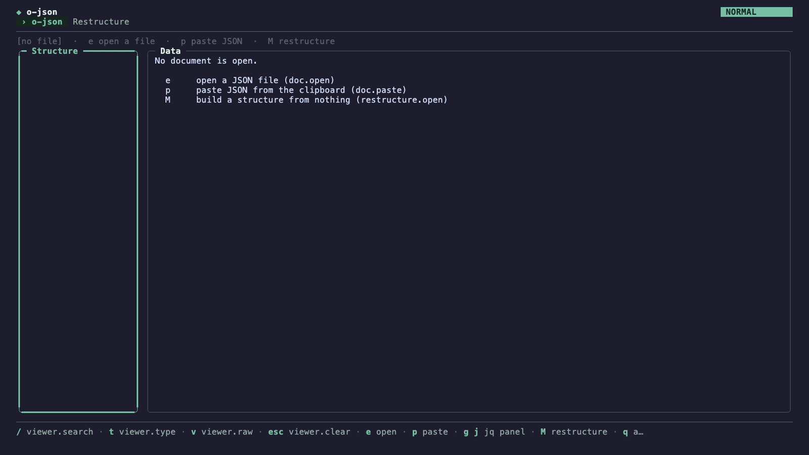
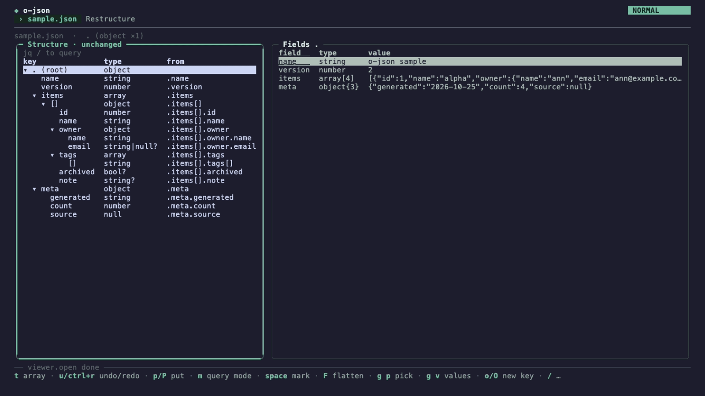
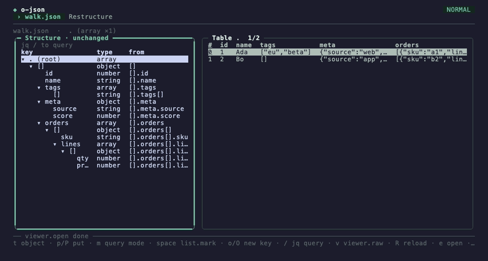
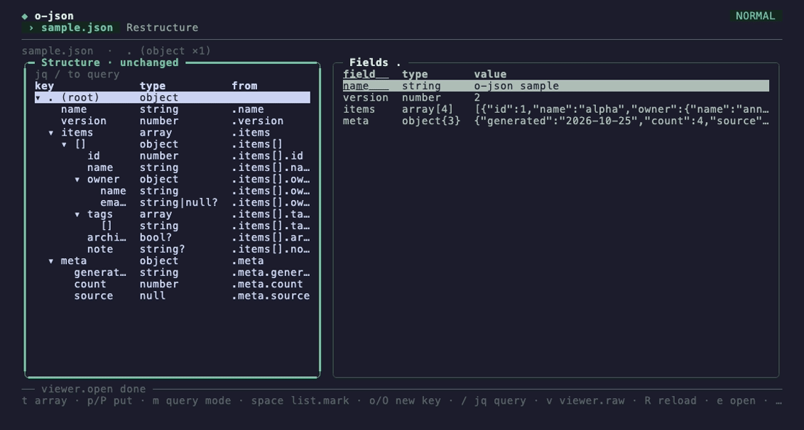

# o-json guide

o-json shows you what a JSON document looks like: its shape, its arrays as tables, and its values. You can also edit it, reshape it, query it with jq and export it. This guide goes task by task. The [README](../README.md) is the full reference, and each chapter links to the part you need.

The viewer has two panels. The **structure** on the left is the document's shape: one row per path, not one per value. The **data** on the right shows whatever the structure has selected. `tab` moves between them. `?` lists every key the focused panel answers to, and `:` opens the command palette, where you can find any verb by name.

The viewer never writes the file you opened. A write always goes to a new file unless you ask to replace one.

1. [Open a document](#1-open-a-document)
2. [Read the shape](#2-read-the-shape)
3. [An array as a table](#3-an-array-as-a-table)
4. [Drill into a row](#4-drill-into-a-row)
5. [Edit values](#5-edit-values)
6. [Restructure the shape](#6-restructure-the-shape)
7. [Query with jq](#7-query-with-jq)
8. [Export and write](#8-export-and-write)
9. [Cheat sheet](#cheat-sheet)

The examples use `testdata/sample.json`: four items, each with an `id`, a `name`, an `owner` and `tags`, and some fields that only a few items have.

## 1. Open a document

You can open a file, read stdin, or start with nothing and pick a file later. Use the last one when you don't yet know which file you want.

1. Open a file: `o-json sample.json`.
2. Or read stdin: `curl -s https://… | o-json`. (`o-json -` reads stdin too.)
3. Or start empty: `o-json`. The top line reads `[no file]  ·  e open a file  ·  p paste JSON  ·  M restructure`, and the data pane says `No document is open.` with the same keys.
4. Press `e` (or `: doc open`) to open a file. The path chooser has three sources: `browse` (the current folder), `recent` (files you opened before) and `typed` (type a path). `ctrl+o` switches source (`alt+o` goes back). Type to narrow the list (`tab` cycles how the text matches: substring, fuzzy or regex), then press `enter`.
5. Or press `p` to paste JSON from the system clipboard. Pasting into the terminal works too: the pasted JSON becomes the document. (`p` pastes a document only in the empty document and the original view, after `T`. In the edited view, `p` puts things: chapters 5 and 6.)
6. `R` reads the file again from disk, keeping your place: the same panel, path, row and column.

**What you'll see:** the breadcrumb at the top names the file, then the selected path and its type. If the JSON is invalid you get an error with its line and column, and the document you had stays open.

If you have unsaved edits, `e`, `R` and `p` ask once before they drop them, and `u` brings the edits back.



Details: [Files and the empty document](../README.md#files-and-the-empty-document).

## 2. Read the shape

The structure tells you every path in the document, its types, and how many values have it. It's the quickest way to understand JSON you didn't write.

1. Move with `j` and `k`. `l` expands a node and `h` collapses it; `enter` folds and unfolds.
2. Each row of the structure is a shape, not a value. `.items[].owner.name` is the owner's name in *every* item.
3. Press `T` for the **original** structure (`Structure · original`). It has a `count` column. `4/4` means all four items have the field, `2/4` that only two do.
4. A field that only some objects have is **optional**. Its name ends in `?` (`email?`, `note?`). In the edited structure (the default, see chapter 6) the `?` comes after the type instead (`string|null?`).
5. Still in the original, press `t` to keep only one type: string, then number, bool, null, object, array, then off. `esc` clears the filter.
6. Press `v` to see the selected path's values as indented JSON. `v` again goes back.
7. On a deep tree, `z +` zooms into the node and `z -` zooms back out.
8. Press `T` again to go back to the edited structure.

**What you'll see:** the data panel follows the selection. An object shows as `field  type  value` rows and an array as a table. A path of plain values (a string, a number) does not replace them: the data panel stays on the table or fields that hold it and highlights its column (scrolled into view, the row kept) or its field row, so `j`/`k` down `.items[].id`, `.items[].name` walks across the table's columns. `: settings set structure.scalar-follow show` shows the values alone instead, as before.

**Searching paths by text:** by default `/` opens the jq query line (chapter 7), which also finds things. If you want the plain path search instead, turn the query line off with `: settings set query.line false`. Then, in the original structure, `/` searches the paths, `n` and `N` go to the next and previous match, and `esc` clears the search. Case is smart, as in Vim with `smartcase`: `name` finds `Name` and `NAME` too, while `Name` finds only `Name` (ochazuke's `search.case` setting: `ignore` or `sensitive` instead).



Details: [Structure](../README.md#structure), [The viewer](../README.md#the-viewer), [Keys](../README.md#keys).

## 3. An array as a table

An array of objects is easiest to read as a table. o-json builds one with a column per key, the most common keys first.

1. Select an array in the structure (`.items`), or a `[]` path (`.items[].owner`).
2. The data panel shows a table. The `#` column is the index. A column whose title ends in `?` is optional, and optional columns come last. A blank cell means the field is missing, which is not the same as `null`.
3. Press `tab` to move into the table. `j`/`k` move between rows; `h`/`l` move between columns; `$` goes to the last column. `g g` and `G` go to the first and last row.
4. Widths stay put while you scroll. `z >` and `z <` widen and narrow a column, `z =` makes them all automatic again, and `g c` picks a column by name.
5. Move the cursor onto a cell that holds an object or an array (`owner`, `tags`). A small **sub-table** of that value opens right under the row.
6. Press `j` to walk down into the sub-table, line by line, and on out to the next row. `h`/`l` move along a sub-table line. A nested value inside it opens one level deeper.

**What you'll see:** only the chain under the cursor is open; move away and the sub-table closes. Deeper values read `{3 keys}` or `[2]` until you reach them.

If you'd rather see a one-line summary in the cell, run `: settings set table.nested summary`. Then `enter` opens the value in the detail (chapter 4).



Details: [Tables](../README.md#tables), and "Nested data in tables" in [The viewer](../README.md#the-viewer).

## 4. Drill into a row

A wide row is easier to read one field per line. The detail shows a row, or any nested value, as labelled rows that you can step into.

1. In the table, put the cursor on the `#` column, or on a plain cell, and press `enter`. The row opens in the detail.
2. On a cell holding an object or array, `enter` opens that value instead.
3. In the detail, `enter` or `l` on an object or array steps into it.
4. `h` or `backspace` steps back out.
5. `q` or `esc` closes the detail.

**What you'll see:** the detail's title is the path you're at (`.items[0].tags  array[2]`). The table stays drawn behind it.


Details: "Detail" in [The viewer](../README.md#the-viewer).

## 5. Edit values

You can fix a value without leaving the viewer. Each edit is one step you can undo, and nothing is written until you ask.

Value edits work in the data panel of the edited view, which is the default. (After `T`, in the original, the data is read-only.)

1. In the table, move to a cell and press `r` (or `i`). The **value editor** opens over the table. Its title is the value's path, the old value is shown dimmed, and the new text is selected, so typing replaces it.
2. A badge shows the type the text will get: a number, `true`/`false`, `null`, JSON for an object or array, otherwise a string. To force a string, quote it: `"42"`. Text that starts like JSON but does not parse gets a note under the field (it would be set as a string). The editor keeps a row for its notes, so the box does not move as you type (`: settings set value.stable-height false` fits the box to the notes it shows).
3. `enter` sets the value. `esc` goes to normal mode and keeps what you typed; a second `esc` sets it too, and `q` there cancels. (`: settings set value.leave cancel` makes the second `esc` cancel instead.)
4. An object or array value opens on several lines. There `enter` adds a new line; press `esc` to go to normal mode, then `enter` (or `esc`) sets the value.
5. `d d` deletes the field (or, on `#`, the whole item).
6. `o` adds after and `O` before. In an object, the editor asks for the key, then `tab` (or `enter`) moves to the value. In an array, it adds an item.
7. `K` renames the key in that one object. If the object already has the key you type, the editor says which name it will use instead (`id-2`), as `o` does.
8. `y` copies the value under the cursor (it also goes to the system clipboard, unless `: settings set clipboard none`; then only `"+y` does), and `p` puts it over another value.
9. `u` undoes and `ctrl+r` redoes, in the table and in the detail.
10. To save, press `w`, type a new file name in the path chooser, and press `enter`. If the file already exists, `w` asks first. `W` replaces a file without asking. On the file you opened, `W` asks you to confirm once.

**What you'll see:** the breadcrumb gets `[+]` and counts your edits (`1 value edit`), and the structure's title reads `edited [+]`. After a write, the `[+]` goes away. `q` asks before quitting with unsaved edits; `Q` quits without asking.

If you prefer to edit on the row itself, use `: settings set value.editor inline`. The keys are the same: `enter` sets, `esc` goes to normal mode, and a second `esc` sets.


Details: "Value edits" in [The viewer](../README.md#the-viewer), and [Settings](../README.md#settings).

## 6. Restructure the shape

Sometimes the shape is wrong: you want fewer fields, different names, or a flatter document. o-json reshapes by **shape**, so one change applies to every item.

**In the viewer.** The structure on the left is editable. It starts as a copy of the document's shape (`Structure · unchanged`). The `from` column shows where each node came from.

1. `r` renames a key. Type the new name, then press `esc`.
2. `d d` deletes a node (into the register). `p` puts it back somewhere else: a delete then a put is a move.
3. `< <` moves a node out one level. Out of an array item, it collects the values into an array (`.items[].id` becomes `.id[]`).
4. `> j` nests a node into the nearest object below it, and `> k` into the nearest one above.
5. `S` wraps a node in a new key. `o` adds a new key below. A new key starts as `new-key`, selected, so you can type its name.
6. `t` turns a key into an array of itself, and back.
7. `V` selects several lines. Then a single key (`>`, `<`, `d`, `y`, `p`, `S`) acts on all of them at once.
8. `u` and `ctrl+r` undo and redo.

The data panel shows the reshaped document as you edit. `T` flips between the original and the edited version. `w` writes the edited document to a new file.

**On the restructure page.** `M` opens a page with the original on the left and the new shape on the right, plus the mapping that turns one into the other. It's better when you'd rather build the result from scratch.

1. Press `M`. The new shape starts empty. `u` brings back the copy.
2. On the original, select a shape and press `s` to send it across. It brings the parents it needs and its fields with it.
3. Press `tab` to go to the restructured tree, and use the keys above (`< <`, `r`, `d d`, …).
4. Watch the **Mapping** panel. It is the restructure, live: `{"from": ".items[].owner.name", "to": ".items[].owner_name"}`.
5. Press `w` to write the result to a new file. `L` switches between the split and single layouts. `q` goes back to the viewer, keeping your edits.

**Save the mapping and reuse it.**

1. Run `: restructure export-map` and type a file name (`people.map.json`).
2. Run it again on any document of the same shape: `o-json restructure data.json --map people.map.json`.
3. Get the same thing as a jq program: `o-json restructure data.json --map people.map.json --jq`.
4. Or, without leaving the viewer, run `: restructure jq`: the program opens in a read-only view (move, `v` to select, `y` to copy, `q` to close). Opening it copies nothing; `y` does. `: restructure mapping` shows the mapping the same way, and `g j` keeps the program on screen beside your edits.

**What you'll see:** the breadcrumb shows `to ← from` for a node that moved. A key that would break the mapping does nothing. For example, `r` on an array item `[]` is ignored, because an item has no key.



Details: [The restructure page](../README.md#the-restructure-page), [restructure](../README.md#restructure).

## 7. Query with jq

jq answers questions the tree can't: which items have tags, how many there are, a few fields side by side. o-json runs jq as you type, with no `jq` binary needed.

**The query line.**

1. Press `/`. The first row of the structure becomes the jq line.
2. Type a query: `.items[] | select(.tags | length > 0) | .owner`. The data panel shows the results as you type.
3. Press `esc` or `enter` to leave the line. The query and its results stay.
4. To clear it: `/`, then `ctrl+u`, then `esc`.
5. `ctrl+f` picks a jq function (type to narrow, `enter`). It's written with an empty slot for each argument, `sub(□; □)`. Typing fills the selected slot, and `tab` selects the next one.

**What you'll see:** field references like `.items[]` are drawn as chips. An error underlines its column, with a caret line naming it, and the last good results stay on screen. When jq builds new objects, the title says `keys sorted`: jq sorts their keys.

**Path completion** is off by default. Turn it on with `: settings set query.complete-paths true`. Then typing `.` offers the field names at that point. `tab` takes one and `esc` dismisses the list.

**Query mode** builds a query from the tree, without typing paths.

1. On the structure, press `m`. The mode badge reads `QUERY`.
2. Move to a field. `.` writes its path into the query, `|` writes it with a pipe, and `]` writes it iterated (`.items[]`).
3. `[` opens an array to fill. Each `.` then adds a field, separated by commas, and `]` closes it. For example `[` `.` `j` `.` `]` gives `[.name, .version]`.
4. `backspace` takes back the last token, and `u` undoes.
5. `m` or `esc` goes back to the normal keys.

To build an object (`{id: .id, name: .name}`), type it in the query line for now. In query mode, `{` writes the first field correctly but not the ones after it.

Value edits pause while query results are shown. Clear the query to edit again.

![A query in the line, cleared with ctrl+u, then [.name, .version] built in query mode](img/07-query.gif)

Details: "The jq query line" and "Query mode" in [The viewer](../README.md#the-viewer), and [query](../README.md#query) for the command line.

## 8. Export and write

A table is often headed for a spreadsheet or another tool. o-json writes an array as csv, tsv, JSON Lines or a Markdown table, from the viewer or the command line.

**From the viewer.**

1. Select an array (or a path inside one) in the structure.
2. Press `w` and give a file name ending in `.csv`, `.tsv`, `.jsonl` or `.md`. That writes the export of the array under the cursor. Any other name writes JSON.
3. Nested objects become dotted columns (`owner.name`). Arrays in a cell are joined with `;` (the settings `export.arrays`, `export.join` and `export.null` change that).
4. With `o-csv` on your PATH, `: viewer open-in` opens the table in o-csv directly. It writes a temporary csv and removes it when o-csv exits.

An export is not the document: your edits stay unsaved (`[+]`) until you write JSON.

**From the command line.**

```sh
o-json export sample.json --of .items                    # csv
o-json export sample.json --of .items --format md        # a Markdown table (also tsv, jsonl)
o-json export sample.json --of .items --columns id,owner.name --out items.csv
o-json export sample.json --of .items --arrays rows      # one row per array item
o-json export data.json --map people.map.json --of .items   # restructure first
o-json table sample.json .items                          # a quick text table
o-json get sample.json '.items[].owner.name' --raw       # values at a path
o-json query sample.json '.items[] | .name'              # a jq query
o-json structure sample.json                             # the shape as text
o-json restructure sample.json --map people.map.json --out people.json
```

`--out` never replaces an existing file unless you add `--overwrite`.


Details: [export](../README.md#export), [Tables](../README.md#tables), [get](../README.md#get), [restructure](../README.md#restructure).

## Cheat sheet

<!-- cheatsheet:start (generated by scripts/cheatsheet.sh from bindings.json; do not edit) -->
The keys below are o-json's defaults; your own `bindings.json` may change them, and `?` always shows the keys as they are.

**Anywhere**

| Keys | Does |
|---|---|
| `?` | every key the focus answers to |
| `:` | the command palette: every verb by name |
| `}` `tab` `ctrl+w w` | the other panel |
| `q` | quit (asks when edits are unsaved) |
| `Q` | quit without asking |

**Open (chapter 1)**

| Keys | Does |
|---|---|
| `e` | open a file (the path chooser) |
| `p` | paste JSON from the clipboard |
| `R` | read the file again |

**Structure tree (chapter 2)**

| Keys | Does |
|---|---|
| `j` `down` | down |
| `k` `up` | up |
| `l` `right` | expand |
| `h` `left` | collapse |
| `enter` | fold or unfold |
| `T` | original / edited structure |
| `t` | type filter (original) |
| `esc` | clear the filter |
| `v` | the values as indented JSON |
| `z +` | zoom into the node |
| `z -` | zoom out a level |

**Table (chapters 3 and 4)**

| Keys | Does |
|---|---|
| `j` `down` | next row (or sub-table line) |
| `k` `up` | previous row |
| `h` `left` | column left |
| `l` `right` | column right |
| `$` | last column |
| `g g` `home` | first row |
| `G` `end` | last row |
| `ctrl+d` | half a screen down |
| `g c` | choose a column |
| `z >` | widen the column |
| `enter` | open the row in the detail |
| `enter` `l` | detail: step into a nested value |
| `h` `backspace` | detail: step back out |
| `q` | close the detail |
| `y` | copy the value under the cursor |

**Edit values (chapter 5)**

| Keys | Does |
|---|---|
| `r` `i` | edit the value |
| `d d` | delete the field or item |
| `o` | add after |
| `O` | add before |
| `K` | rename the key |
| `p` | put the copied value here |
| `enter` | editor: set |
| `esc` | editor: normal mode, the text kept |
| `esc` | editor: leave (value.leave: set or cancel) |
| `q` | editor: cancel |
| `enter` `tab` | editor: key to value |
| `u` | undo |
| `ctrl+r` | redo |
| `w` | write a new file |
| `W` | write over a file |

**Restructure (chapter 6)**

| Keys | Does |
|---|---|
| `M` | open the restructure page |
| `s` | send a shape across |
| `tab` | page: the other tree |
| `> j` `g >` | nest into the object below |
| `> k` `> >` | nest into the object above |
| `< <` | move out a level |
| `S` | wrap in a new key |
| `t` | key to array, and back |
| `r` | rename the key |
| `d d` | delete into the register |
| `y y` | yank |
| `p` | put below |
| `o` | new key below |
| `V` | select several lines |
| `L` | page: split or single layout |
| `q` | page: back to the viewer |

**Query (chapter 7)**

| Keys | Does |
|---|---|
| `/` | focus the jq query line |
| `esc` `enter` | leave the line (the query stays) |
| `ctrl+f` | pick a jq function |
| `tab` | the next empty argument |
| `tab` `enter` | take the completion |
| `m` | query mode on the tree |
| `.` | query mode: the field's path |
| `\|` | query mode: path and a pipe |
| `]` | query mode: path, iterated |
| `[` | query mode: open a bracket |
| `,` | query mode: a comma |
| `backspace` | query mode: take back a token |
<!-- cheatsheet:end -->
